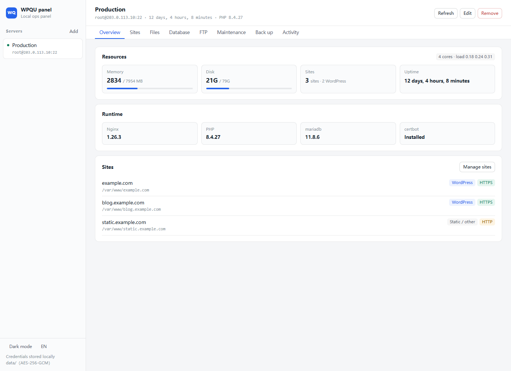

<!--
Release binaries are built with ./build.sh all; attach dist/* plus dist/SHA256SUMS to a GitHub release.
-->
# WPQU panel

**English** ｜ [简体中文](README.zh-CN.md)

A single-binary control panel for WordPress servers. It runs on your own machine, talks to your
servers over SSH, and keeps everything — UI, remote scripts, HTTP server — inside one executable.
Nothing has to be installed on the server beyond the ordinary nginx / Apache + PHP-FPM + database
stack that WordPress already needs.

[](LICENSE)
[](go.mod)
[](#install)
[](#interface-language)



## Why another panel

Most hosting panels assume they *are* the server: you install them on the box, they own the stack,
and they grow a login system, a database of users, and a web-facing attack surface.

WPQU panel goes the other way. It is a **local tool** — a small web app that runs on `127.0.0.1`
on your laptop, keeps your server list in a local encrypted file, and drives the servers over SSH
the same way you would by hand. The server keeps a plain, reproducible nginx/Apache + PHP-FPM setup
that you can still maintain with `vim` and `systemctl` when the panel is not around.

- **One file, no runtime.** No Node, no Docker, no Python. `wpqu-panel.exe` double-clicks into a browser.
- **No agent.** Scripts are uploaded to `/tmp`, executed as root, and deleted. Nothing listens on the server.
- **No lock-in.** Every action maps to a readable bash script in [`scripts/`](scripts) — read it, run it yourself.
- **Bilingual UI.** English and Simplified Chinese out of the box; adding a third language is three small edits.

## Features

| Area | What you can do |
|---|---|
| **Servers** | Add any number of servers (password or private key), test connectivity, run a 9-point health check before touching anything |
| **Environment** | One-click install of the whole stack, or a custom mix: nginx / Apache, PHP 8.0–8.4, MariaDB / MySQL 8.4 / MySQL 5.7 |
| **Sites** | Create WordPress, "custom PHP" or static sites; convert between the three; rename a domain (with 301 from the old one); delete a site including files, database and certificate |
| **Files** | Browse, edit, upload/download, rename, chmod (octal, recursive), batch operations, SFTP-backed |
| **Database** | Browse databases/tables/rows, run SQL, export and import dumps, `OPTIMIZE TABLE` |
| **FTP** *(optional)* | Install vsftpd on demand, create accounts bound to a site directory and its owner UID, read-only or read-write |
| **Maintenance** | Install/remove PHP versions, move a site to another PHP version, view/rotate/clear site logs, manage root crontab, run arbitrary commands |
| **Back up** | Tarball a site (files + optional database dump) and keep it locally under `data/backups/` |
| **Activity** | Append-only log of every operation, per server, with duration and result |
| **Plugins** | Signed marketplace from `panel.wpqu.com`: install OpenClaw, Go, Python, Node.js or Docker on a server in one click. UI plugins add tabs to the panel itself. Free and paid are marked; paid ones use offline license keys |
| **Self-update** | Check → verify Ed25519 signature and SHA256 → replace and restart. On Windows it renames the running binary and rolls back on failure |
| **Set password** *(optional)* | Per-server local encryption of stored credentials: passphrase-derived key (scrypt → AES-256-GCM), no strength check, 5 wrong attempts lock it for one hour, unlock lasts 30 minutes. The passphrase is never written to disk |
| **Interface** | Light / dark toggle (two buttons); EN / 简体中文 switch; link to panel.wpqu.com in the sidebar; `?lang=en` deep link |

Sites are managed through one abstraction, so an **nginx** box and an **Apache** box behave the same
in the panel: the same buttons, the same dialogs, the right config paths underneath.

## Plugins and updates

The panel ships a plugin marketplace and a self-update channel, both served from the static site at
`panel.wpqu.com`. **Every artifact carries a detached Ed25519 signature.**

Two kinds of plugins:

| Kind | Installed on | Examples |
|---|---|---|
| Server recipe | The target server, scripts run as root | OpenClaw, Go, Python, Node.js, Docker |
| Panel module | The panel itself, adds a tab | Notes |

Paid plugins use offline license keys — `WPQU1.<payload>.<signature>` — verified locally with a public
key baked into the binary. No account, no network call. Issue keys with `panel-go/cmd/wpqusign`; build
and sign release artifacts with `panel-go/cmd/wpqupack`.

Self-hosting the feed is just static files: point `WPQU_UPDATE_BASE` at your own domain. You must sign
with the same tooling, otherwise the panel refuses to install — by design.

Those two CLIs are for scripts. If you'd rather click, the repo also ships a companion admin console,
`panel-go/cmd/wpquadmin` (`./build.sh admin`): edit plugin manifests, pack and publish in one click,
issue per-plugin keys and keep a ledger. It calls the same `internal/pack` and `internal/licensing`
code, so artifacts are byte-identical to the CLI's. It listens on `127.0.0.1` only and is meant for
whoever runs the feed — it does not talk to the panel.

See [docs/GUIDE.md](docs/GUIDE.md) and [docs/ARCHITECTURE.md](docs/ARCHITECTURE.md).

## Install

### Use a release binary

Download the archive for your platform from the [releases page](https://github.com/oldlong/wpqu-panel/releases) — or build it
yourself, it takes about ten seconds:

| Platform | File | Notes |
|---|---|---|
| Windows | `wpqu-panel-windows-amd64.exe` | Double-click. No console window, opens your browser. |
| Windows (diagnostics) | `wpqu-panel-windows-amd64-console.exe` | Same thing with a console, so startup errors are visible |
| Linux | `wpqu-panel-linux-amd64` | `chmod +x` and run |
| macOS | `wpqu-panel-darwin-arm64` / `-amd64` | `chmod +x` and run; Gatekeeper may need *Open Anyway* |

Every file is a single self-contained executable of about 9 MB: UI, remote scripts and HTTP server
included. Nothing to install alongside it.

```bash
# Linux / macOS
chmod +x wpqu-panel-linux-amd64
./wpqu-panel-linux-amd64            # http://127.0.0.1:7788, browser opens automatically
```

### Build from source

```bash
git clone https://github.com/oldlong/wpqu-panel.git
cd wpqu-panel
./build.sh                 # current platform
./build.sh all             # cross-compile every release target into ./dist (+ SHA256SUMS)
```

Requires Go 1.24 or newer; no CGO. On Windows, `build.bat` produces both executables.

### First run

1. Start the panel. It listens on `127.0.0.1:7788`; if that port is taken it walks up to `7789`,
   `7790`, … and prints the address it settled on.
2. Add a server: IP, SSH port, user (root, or a user with passwordless `sudo`), password or private key.
3. Press **Health check** — it verifies SSH, OS, web server, PHP, database, WP-CLI, certbot, disk and time.
4. On a bare machine, use **Initialize environment** to install the stack and configure the first site.

### Requirements on the server

- Debian 12/13 or Ubuntu 22.04/24.04 (x86_64 or arm64)
- SSH access as `root`, or a user with `sudo -n` (passwordless)
- Ports 80 and 443 reachable if you want Let's Encrypt certificates
- A publicly resolvable domain for each site you want HTTPS on

## What gets installed on the server

The panel never installs a daemon of its own. **Initialize environment** installs and configures:

| Component | Default | Options |
|---|---|---|
| Web server | nginx | Apache 2.4 (`mpm_event` + `proxy_fcgi`) |
| PHP | distribution default | 8.0 / 8.1 / 8.2 / 8.3 / 8.4; sites share one FPM pool per version, or get their own on request |
| Database | MariaDB | MySQL 8.4 LTS, MySQL 5.7 (Debian only) |
| Tools | WP-CLI, certbot (+ webroot plugin), unzip, curl | — |
| FTP | not installed | vsftpd, installed from the FTP tab on demand |

Resulting layout for a site `example.com`:

```
/var/www/example.com/                          site root
/etc/nginx/sites-available/example.com         vhost (+ snippets/site-example.com.conf)
/etc/wp-panel/site-types/example.com           site type marker (wordpress / custom / static)
/etc/php/8.4/fpm/pool.d/example.com.conf       PHP-FPM pool (only with a per-site pool)
/etc/letsencrypt/live/example.com/             certificate (when HTTPS is enabled)
/var/log/nginx/example.com.{access,error}.log  logs
```

On an Apache box the first two become `/etc/apache2/sites-available/example.com.conf` and
`/etc/apache2/sites-enabled/example.com.conf`; the type marker, pool and certificate paths are the same.

Nothing is added to `cron`, no service is enabled beyond the ones above, and no port is opened for
the panel itself.

## How it works

```
┌───────────────────────┐   SSH (exec / SFTP)   ┌────────────────────────────┐
│ your machine          │ ────────────────────► │ server                     │
│ wpqu-panel (1 binary) │                       │ bash script → /tmp → root  │
│  ├ public/  (UI)      │ ◄──────────────────── │ nginx / apache / php-fpm   │
│  ├ scripts/ (bash)    │   stdout, streamed    │ mariadb / mysql            │
│  └ data/    (profile) │                       │ certbot, wp-cli            │
└───────────────────────┘                       └────────────────────────────┘
```

Each action uploads one self-contained bash script over SFTP, runs it with `env VAR=... bash /tmp/...`,
streams stdout back to the browser as newline-delimited JSON, and deletes the script afterwards.
That is the whole protocol — see [docs/ARCHITECTURE.md](docs/ARCHITECTURE.md) for the details and
[docs/API.md](docs/API.md) for the HTTP surface.

## Security

The panel is a **local administration tool with no login screen**: whoever can reach the port can
drive your servers as root. It therefore binds to `127.0.0.1` only, refuses write requests without
the `x-panel: 1` header, encrypts stored credentials with AES-256-GCM, and asks for typed
confirmation before destructive actions. Use an SSH tunnel if you need to reach it from elsewhere.

Known limitations and the full threat model: [SECURITY.md](SECURITY.md).

## Interface language

The UI ships with English and Simplified Chinese. The switch sits at the bottom of the sidebar and
remembers your choice per browser; `?lang=en` or `?lang=zh-CN` forces a language for a single link.
Missing translations fall back to the Chinese source string, so a partial language pack is always
usable. Adding a language is three edits in `public/i18n/` — see
[docs/ARCHITECTURE.md § Interface language](docs/ARCHITECTURE.md#9-interface-language).

Note that messages *produced by the remote scripts* (installer output, log lines, command results)
are Chinese; the UI language covers the panel's own interface.

## Documentation

| Document | Contents |
|---|---|
| [docs/GUIDE.md](docs/GUIDE.md) | Step-by-step guide: install, add a server, every tab explained, troubleshooting |
| [docs/ARCHITECTURE.md](docs/ARCHITECTURE.md) | How the panel, the scripts and the browser fit together; how to add a feature |
| [docs/API.md](docs/API.md) | All HTTP endpoints, request fields, streaming format |
| [SECURITY.md](SECURITY.md) | Threat model, guarantees, known gaps, reporting |
| [CONTRIBUTING.md](CONTRIBUTING.md) | Build, test, code layout, pull request checklist |
| [CHANGELOG.md](CHANGELOG.md) | Version history |

## Project status

Version 1.10.0. The panel is used daily against a handful of real Debian/Ubuntu servers, but treat it
as a one-maintainer project: the API may still change between minor versions, and release binaries
are unsigned.

Tested combinations: Debian 13 + MariaDB 11 + nginx, Debian 13 + MySQL 8.4 + nginx, Debian 13 +
Apache 2.4 + PHP 8.4 + MariaDB. See [CHANGELOG.md](CHANGELOG.md) for what changed when.

Code comments are mostly Chinese (the project started in Chinese); English comments and English PRs
are equally welcome.

## License

[GPL-3.0](LICENSE). You can use, modify and redistribute it, including commercially, as long as
derivative distributions stay under the same license and keep the notices.
