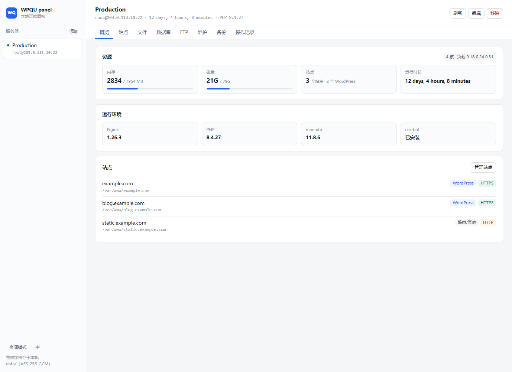

<!--
发布包用 ./build.sh all 生成，把 dist/* 与 dist/SHA256SUMS 传到 GitHub release 即可。
-->
# WPQU panel

[English](README.md) ｜ **简体中文**

一个单文件的 WordPress 服务器管理面板。它跑在你自己的电脑上，通过 SSH 操作服务器，界面、远端脚本、
HTTP 服务全部装进一个可执行文件里。服务器上不需要额外装任何东西——nginx / Apache + PHP-FPM +
数据库这套 WordPress 本来就需要的环境除外。

[](LICENSE)
[](go.mod)
[](#安装)
[](#界面语言)



## 为什么又做一个面板

常见的建站面板假设自己**就是**那台服务器：装在服务器上、接管整套环境，于是慢慢长出账号体系、
自己的数据库、以及一个暴露在公网的攻击面。

WPQU panel 反过来：它是一个**本地工具**。一个只监听 `127.0.0.1` 的小网页，服务器清单存在本地的
加密文件里，操作全部通过 SSH 下发——和你自己敲命令是同一件事。服务器上留下的是一套干净、可复现的
nginx/Apache + PHP-FPM 环境，面板不在了，你用 `vim` 和 `systemctl` 照样维护。

- **一个文件，没有运行时**：不需要 Node、Docker、Python，`wpqu-panel.exe` 双击即开浏览器
- **没有 agent**：脚本上传到 `/tmp`、以 root 执行、执行完删掉，服务器上不监听任何新端口
- **不锁定**：每个动作都对应 [`scripts/`](scripts) 里一份能读的 bash 脚本，你可以自己跑一遍
- **中英双语**：内置英文与简体中文，加第三门语言只需改三个小地方

## 功能

| 模块 | 能做什么 |
|---|---|
| **服务器** | 添加任意多台（密码或私钥）、测连通性、动手前先跑 9 项环境体检 |
| **环境** | 一键装全套，也可自选组合：nginx / Apache、PHP 8.0–8.4、MariaDB / MySQL 8.4 / MySQL 5.7 |
| **站点** | 新建 WordPress / 自助 PHP / 纯静态站；三者互相转换；换域名（旧域名自动 301）；整站删除（可含文件、数据库、证书） |
| **文件** | 浏览、编辑、上传下载、重命名、改权限（八进制、可递归）、批量操作，走 SFTP |
| **数据库** | 浏览库表与数据、执行 SQL、导出导入、`OPTIMIZE TABLE` |
| **FTP**（可选） | 按需安装 vsftpd，账号绑到站点目录与属主 UID，只读或读写 |
| **维护** | 安装/卸载 PHP 版本、把站点切到另一版本、查看/轮转/清空站点日志、管理 root crontab、执行任意命令 |
| **备份** | 把站点打包（文件 + 可选数据库导出）存到本地 `data/backups/` |
| **操作记录** | 每一次操作按服务器留档：耗时、结果、失败原因 |
| **插件市场** | 从 `panel.wpqu.com` 拉签名过的清单，一键在服务器上装 OpenClaw（小龙虾）/ Go / Python / Node.js / Docker；也有装进面板的界面插件。免费与收费分标，收费插件用离线授权码 |
| **自升级** | 检查更新 → 验 Ed25519 签名与 SHA256 → 替换自身并重启；Windows 用重命名替换，失败会回滚 |
| **设置密码**（可选） | 按服务器的凭据本地加密：口令派生密钥（scrypt → AES-256-GCM）重加密，不校验强度，连错 5 次锁 1 小时，解锁会话 30 分钟；口令本身不落盘 |
| **界面** | 深色 / 浅色两键切换；中英切换（侧栏 CH / EN）；侧栏底部有官网入口；可用 `?lang=zh-CN` 直接指定语言 |

站点管理做了统一抽象，所以 **nginx** 机器和 **Apache** 机器在面板里表现一致：按钮、弹窗、流程都一样，
底下落到各自的配置路径。

## 插件与升级

面板带一个插件市场和一个自更新通道，两者都挂在 `panel.wpqu.com` 这个静态站上，**全部产物都有 Ed25519 分离签名**。

插件分两类：

| 类型 | 装在哪 | 例子 |
|---|---|---|
| 服务器部署 | 目标服务器，脚本以 root 执行 | OpenClaw、Go、Python、Node.js、Docker |
| 面板增强 | 面板本机，装完多一个页签 | 便签 |

收费插件用离线授权码：`WPQU1.<payload>.<signature>`，面板内置授权公钥本地验签，不联网、不需要账号体系。
签发工具在 `panel-go/cmd/wpqusign`，打包与签名升级包在 `panel-go/cmd/wpqupack`。

这两个命令行工具是给脚本用的。要更省事的话，仓库里还有一个同源的管理后台 `panel-go/cmd/wpquadmin`（`./build.sh admin`）：网页上改插件清单、一键打包发布、按插件发码并管台账，调的是 `internal/pack` 与 `internal/licensing` 同一份代码，产物与命令行逐字节相同。它只监听 `127.0.0.1`，是自建分发站的人自己用的工具，和面板不互相依赖。

自己搭分发站也简单：整套是纯静态文件，改 `WPQU_UPDATE_BASE` 指到你自己的域名即可（但要用同一套工具签名，否则面板会拒绝）。

细节见 [docs/GUIDE.zh-CN.md](docs/GUIDE.zh-CN.md) 和 [docs/ARCHITECTURE.zh-CN.md](docs/ARCHITECTURE.zh-CN.md)。

## 安装

### 直接用发布包

到 [releases 页面](https://github.com/oldlong/wpqu-panel/releases) 下载对应平台的包，或者自己编译——大概十秒：

| 平台 | 文件 | 说明 |
|---|---|---|
| Windows | `wpqu-panel-windows-amd64.exe` | 双击运行，不弹命令行窗口，自动开浏览器 |
| Windows（排查用） | `wpqu-panel-windows-amd64-console.exe` | 同上但带控制台，启动失败时能看到原因 |
| Linux | `wpqu-panel-linux-amd64` | `chmod +x` 后运行 |
| macOS | `wpqu-panel-darwin-arm64` / `-amd64` | `chmod +x` 后运行；Gatekeeper 可能要求「仍要打开」 |

每个文件都是约 9 MB 的自包含可执行文件：界面、远端脚本、HTTP 服务都在里面，旁边不用装任何东西。

```bash
# Linux / macOS
chmod +x wpqu-panel-linux-amd64
./wpqu-panel-linux-amd64            # http://127.0.0.1:7788，会自动打开浏览器
```

### 从源码编译

```bash
git clone https://github.com/oldlong/wpqu-panel.git
cd wpqu-panel
./build.sh                 # 当前平台
./build.sh all             # 交叉编译所有发布目标到 ./dist（含 SHA256SUMS）
```

需要 Go 1.24 或更新版本，不依赖 CGO。Windows 上双击 `build.bat`，会同时产出 GUI 版与控制台版。

### 第一次使用

1. 启动面板。默认监听 `127.0.0.1:7788`，端口被占用时自动顺延到 `7789`、`7790`…，实际地址会打出来
2. 添加服务器：IP、SSH 端口、用户（root，或有免密 `sudo` 的用户）、密码或私钥
3. 点 **环境体检**：SSH、系统、Web 服务器、PHP、数据库、WP-CLI、certbot、磁盘、时间一次查完
4. 空机器上用 **初始化环境** 装好整套环境并配好第一个站点

### 服务器要求

- Debian 12/13 或 Ubuntu 22.04/24.04（x86_64 或 arm64）
- 能以 `root` 登录，或该用户能 `sudo -n`（免密）
- 要签 Let's Encrypt 证书的话，80 / 443 需可达
- 想上 HTTPS 的站点，域名要能解析到这台机器

## 服务器上装了什么

面板自己不装任何常驻服务。**初始化环境** 会安装并配置：

| 组件 | 默认 | 可选 |
|---|---|---|
| Web 服务器 | nginx | Apache 2.4（`mpm_event` + `proxy_fcgi`） |
| PHP | 发行版默认版本 | 8.0 / 8.1 / 8.2 / 8.3 / 8.4；同版本的站点共用一个 FPM pool，也可按站点要独立 pool |
| 数据库 | MariaDB | MySQL 8.4 LTS、MySQL 5.7（仅 Debian） |
| 工具 | WP-CLI、certbot（含 webroot 插件）、unzip、curl | — |
| FTP | 不安装 | vsftpd，在 FTP 页按需安装 |

站点 `example.com` 落盘后的样子：

```
/var/www/example.com/                          站点根目录
/etc/nginx/sites-available/example.com         站点配置（+ snippets/site-example.com.conf）
/etc/wp-panel/site-types/example.com           站点类型标记（wordpress / custom / static）
/etc/php/8.4/fpm/pool.d/example.com.conf       PHP-FPM pool（仅勾选独立 pool 时）
/etc/letsencrypt/live/example.com/             证书（启用 HTTPS 时）
/var/log/nginx/example.com.{access,error}.log  日志
```

Apache 机器上前两项换成 `/etc/apache2/sites-available/example.com.conf` 与
`/etc/apache2/sites-enabled/example.com.conf`，类型标记、pool、证书路径一致。

除此之外不写 `cron`、不加开机自启、不为面板本身开任何端口。

## 工作原理

```
┌───────────────────────┐   SSH（exec / SFTP）  ┌────────────────────────────┐
│ 你的电脑              │ ────────────────────► │ 服务器                     │
│ wpqu-panel（单文件）  │                       │ bash 脚本 → /tmp → root    │
│  ├ public/  （界面）  │ ◄──────────────────── │ nginx / apache / php-fpm   │
│  ├ scripts/ （bash）  │   流式返回 stdout     │ mariadb / mysql            │
│  └ data/    （档案）  │                       │ certbot、wp-cli            │
└───────────────────────┘                       └────────────────────────────┘
```

每个动作都是：把一份自包含的 bash 脚本用 SFTP 传上去 → `env VAR=... bash /tmp/...` 执行 →
stdout 按行以 JSON 流回浏览器 → 脚本删掉。协议就这么点，细节见
[docs/ARCHITECTURE.md](docs/ARCHITECTURE.md)，HTTP 接口见 [docs/API.md](docs/API.md)。

## 安全

本面板是**没有登录界面的本地管理工具**：能访问端口的人就能以 root 身份操作你的服务器。因此它只监听
`127.0.0.1`、写操作必须带 `x-panel: 1` 头、凭据用 AES-256-GCM 加密存放、危险操作要求手工输入确认字串。
需要远程访问时请走 SSH 隧道。

已知限制与完整威胁模型见 [SECURITY.zh-CN.md](SECURITY.zh-CN.md)。

## 界面语言

内置英文与简体中文。切换按钮在侧栏左下角，选择按浏览器记住；`?lang=zh-CN` / `?lang=en` 可让某条链接
强制使用指定语言。缺译会自动回退成中文原文，所以只翻了一半的语言包也能用。加一门语言只改
`public/i18n/` 里三个地方，见 [docs/ARCHITECTURE.zh-CN.md § 界面语言](docs/ARCHITECTURE.zh-CN.md#9-界面语言)。

需要说明的是：**远端脚本产生的内容**（安装输出、日志正文、命令结果）是中文，语言切换只覆盖面板自身的界面。

## 文档

| 文档 | 内容 |
|---|---|
| [docs/GUIDE.zh-CN.md](docs/GUIDE.zh-CN.md) | 逐步操作指南：安装、加服务器、每个页签怎么用、排错 |
| [docs/ARCHITECTURE.zh-CN.md](docs/ARCHITECTURE.zh-CN.md) | 面板、脚本、浏览器怎么协作；怎么加功能 |
| [docs/API.zh-CN.md](docs/API.zh-CN.md) | 全部 HTTP 接口、请求字段、流式格式 |
| [SECURITY.zh-CN.md](SECURITY.zh-CN.md) | 威胁模型、安全承诺、已知缺口、漏洞上报 |
| [CONTRIBUTING.zh-CN.md](CONTRIBUTING.zh-CN.md) | 编译、测试、代码结构、PR 检查清单 |
| [CHANGELOG.md](CHANGELOG.md) | 版本变更记录 |

## 项目状态

当前版本 1.9.3。日常在几台真实 Debian/Ubuntu 服务器上使用，但仍属单人维护项目：小版本之间接口仍可能
调整，发布包没有代码签名。

已验证的组合：Debian 13 + MariaDB 11 + nginx、Debian 13 + MySQL 8.4 + nginx、Debian 13 + Apache 2.4 +
PHP 8.4 + MariaDB。具体变更见 [CHANGELOG.md](CHANGELOG.md)。

代码注释以中文为主（项目从中文起家），英文注释与英文 PR 同样欢迎。

## 许可

[GPL-3.0](LICENSE)。可自由使用、修改、再分发（包括商用），但衍生分发需沿用同一协议并保留声明。
