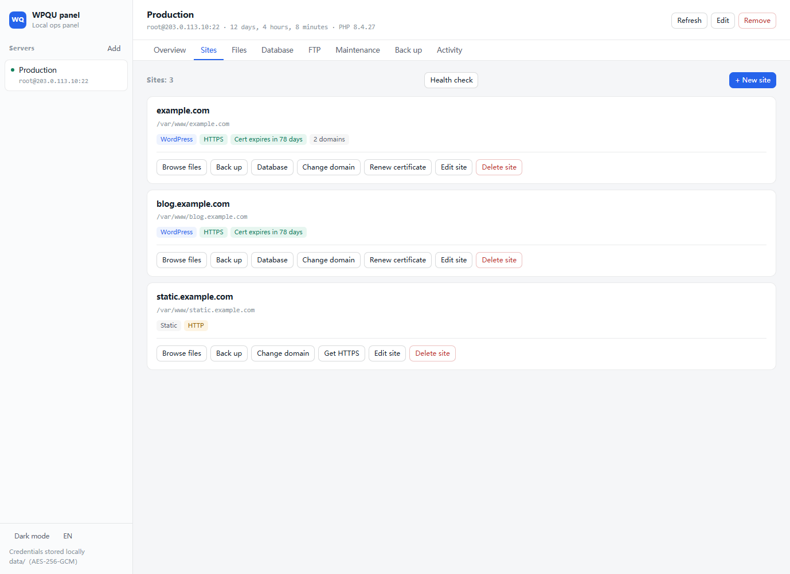
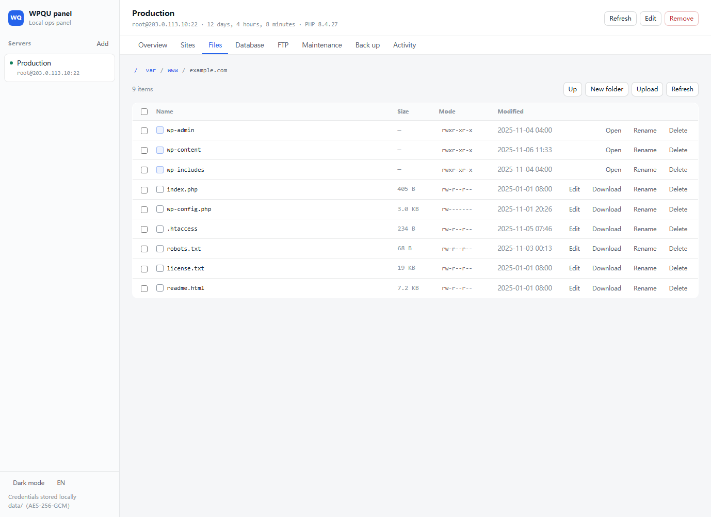

# Guide

**English** ｜ [简体中文](GUIDE.zh-CN.md)

This is the task-oriented manual: how to install the panel, connect a server, and use every tab.
For internals see [ARCHITECTURE.md](ARCHITECTURE.md), for endpoints see [API.md](API.md).

- [1. Before you start](#1-before-you-start)
- [2. Install and run](#2-install-and-run)
- [3. Add your first server](#3-add-your-first-server)
- [4. Initialize a bare server](#4-initialize-a-bare-server)
- [5. Sites](#5-sites)
- [6. Files](#6-files)
- [7. Database](#7-database)
- [8. FTP](#8-ftp)
- [9. Maintenance](#9-maintenance)
- [10. Backups](#10-backups)
- [11. Activity log](#11-activity-log)
- [12. Set a password](#12-set-a-password)
- [13. Interface settings](#13-interface-settings)
- [14. Plugins](#14-plugins)
- [15. Updates](#15-updates)
- [16. Troubleshooting](#16-troubleshooting)
- [17. Removing the panel](#17-removing-the-panel)

## 1. Before you start

**On your machine** (where the panel runs): Windows 10+, macOS 12+, or a Linux desktop. No runtime
needed — the release binary is self-contained.

**On the server**:

| Item | Requirement |
|---|---|
| OS | Debian 12/13, Ubuntu 22.04/24.04 (x86_64 / arm64) |
| Access | SSH as `root`, or a user with passwordless `sudo` |
| Network | 80 and 443 reachable for HTTP/HTTPS and Let's Encrypt |
| DNS | an A record pointing at the server for every domain you want a certificate for |

The panel assumes it is the only thing managing those sites. If nginx/Apache is already configured by
hand with a layout you care about, read [§5](#5-sites) first — the panel manages
`/etc/nginx/sites-available` (or `/etc/apache2/sites-available`) on its own terms.

## 2. Install and run

### Windows

Download `wpqu-panel-windows-amd64.exe`, put it somewhere permanent (e.g. `C:\Tools\wpqu-panel\`),
and double-click. It starts, waits for the listener, then opens your default browser.

- No console window appears. If it refuses to start, run `wpqu-panel-windows-amd64-console.exe`
  from a terminal — that one prints the reason.
- Double-clicking again does **not** start a second process: it finds the running instance, compares
  versions, and either reuses it or replaces it.
- `wpqu-panel.exe -stop` stops it (a message box appears, since there is no console).

### Linux / macOS

```bash
chmod +x wpqu-panel-linux-amd64
./wpqu-panel-linux-amd64
```

On macOS, if Gatekeeper blocks the unsigned binary: right-click → Open, or
`xattr -d com.apple.quarantine wpqu-panel-darwin-arm64`.

### Run it as a service (optional)

Only do this on a machine you trust — the panel has no login, so a service on `0.0.0.0` would let
anyone drive your servers. The unit below keeps it on loopback.

```ini
# /etc/systemd/system/wpqu-panel.service
[Unit]
Description=WPQU panel
After=network-online.target

[Service]
Type=simple
User=youruser
ExecStart=/opt/wpqu-panel/wpqu-panel -no-browser
Restart=on-failure
Environment=PANEL_DATA=/opt/wpqu-panel/data

[Install]
WantedBy=multi-user.target
```

```bash
sudo systemctl daemon-reload && sudo systemctl enable --now wpqu-panel
```

### Command-line flags

| Flag | Env | Default | Meaning |
|---|---|---|---|
| `-port` | `PORT` | `7788` | Listen port. If busy, the panel tries the next 20 ports |
| `-host` | `HOST` | `127.0.0.1` | Listen address. Keep it on loopback |
| `-data` | `PANEL_DATA` | see below | Data directory |
| `-no-browser` | — | off | Do not open a browser on startup |
| `-stop` | — | — | Stop the instance listening on `-port` |

### Data directory

Profiles live outside the working directory, so moving the binary does not lose your servers:

| OS | Path |
|---|---|
| Windows | `%APPDATA%\wpqu-panel\data` |
| macOS / Linux | `~/.config/wpqu-panel/data` |

```
data/
├── servers.json      server list; passwords and keys are AES-256-GCM ciphertext
├── secret.key        32-byte key (base64). Lose it and stored credentials cannot be decrypted
├── panel.log         startup log — the first place to look when the GUI build stays silent
├── logs/             one .ndjson per day, every operation
└── backups/          site archives, one subdirectory per server
```

If a `servers.json` is found next to the binary (or in the old `wp-panel` directory from before the
rename), it is copied into the default location once, on first start. The source is never deleted.

Two independent instances (e.g. work and personal profiles):

```bash
PANEL_DATA=~/.config/wpqu-panel-work/data ./wpqu-panel -port 7790
```

## 3. Add your first server

Sidebar → **Add** → fill in:

| Field | Notes |
|---|---|
| Name | anything, for your own reference (`Production`, `VPS-Frankfurt`) |
| Host | IPv4, IPv6 or hostname |
| Port | SSH port, default 22 |
| User | `root`, or a user with passwordless `sudo` |
| Auth | password, or a private key (OpenSSH format, with optional passphrase) |

Press **Test** — it opens an SSH connection and runs a trivial command. Then **Health check**, which
verifies nine things and prints a checklist:

| Check | Fails when |
|---|---|
| SSH | connection refused, auth failed, host unreachable |
| OS | not Debian/Ubuntu |
| Web server | neither nginx nor Apache is installed/running |
| PHP-FPM | no `php*-fpm` service |
| Database | neither MariaDB nor MySQL installed, or `root` cannot connect without a password |
| WP-CLI | missing or broken — site creation and domain changes depend on it |
| Disk | less than a sensible amount free |
| Certbot | missing, so HTTPS cannot be issued |
| Time | clock drift large enough to break TLS |

Health check is read-only. Run it before your first write operation; it catches most problems early.

## 4. Initialize a bare server

**Sites → Initialize environment** walks through: web server, PHP version, database engine, then the
first site.

| Choice | Options | Notes |
|---|---|---|
| Web server | nginx (default), Apache 2.4 | Apache uses `mpm_event` + `proxy_fcgi`, `.htaccess` for WordPress rules |
| PHP | distribution default, 8.0–8.4 | Missing versions pull a Sury/ondrej repository automatically |
| Database | MariaDB (default), MySQL 8.4 LTS, MySQL 5.7 | MySQL 5.7 only on Debian; it needs the archived Oracle packages |
| First site | domain, title, admin user/password/email, HTTPS on/off | WordPress is downloaded and installed via WP-CLI |

The installer is idempotent: running it again on a configured machine re-checks components instead of
reinstalling them. Existing `php.ini` and pool files are backed up before being replaced.

Progress streams live in a drawer. If a step fails, the drawer shows the exact line, and the operation
is recorded in the activity log. Nothing is silently swallowed.

## 5. Sites

The **Sites** tab lists what the panel can see — read from the web server's own configuration, not
from a database of its own:

| Column | Source |
|---|---|
| Domain | `server_name` (nginx) / `ServerName` + `ServerAlias` (Apache) |
| Type | marker in `/etc/wp-panel/site-types/<domain>` |
| PHP | whether a `fastcgi_pass` / `proxy:unix:` handler points at an FPM socket |
| HTTPS | the vhost listens on 443 or has a certificate |
| Root | `root` / `DocumentRoot` |

Vhosts that are pure redirects (no document root) are listed separately and can be deleted, but not
edited — they exist to 301 an old domain.



### Create a site

**Add site** asks for a domain and a type:

| Type | What is created |
|---|---|
| **WordPress** | directory, database and user, `wp-config.php`, WP-CLI install, permalink rules, vhost, optional certificate |
| **Custom PHP** | directory with a placeholder `index.php`, PHP-FPM pool, vhost — for apps you upload yourself |
| **Static** | directory with a placeholder `index.html`, vhost with PHP disabled (`.php` returns 403) |

Options: separate PHP-FPM pool (default: share one pool per PHP version), PHP version, HTTPS
(via certbot webroot), admin credentials and language for WordPress.

### Convert a site

**Type → Convert** rewrites the capability part of the vhost and, when moving *to* WordPress, installs
a fresh copy — it does not adopt existing files into a WordPress install. Going *from* WordPress keeps
the files and database untouched; the WordPress rewrite rules are parked aside
(`.htaccess` → `.htaccess.wp-bak-<timestamp>` on Apache), so switching back is lossless.

The old configuration is archived to `/root/` first; if the web server's config test fails, it is restored.

### Change the domain

**Change domain** works on WordPress sites only (it must rewrite `siteurl` / `home` in the database):

1. renames `/var/www/<old>` → `/var/www/<new>`,
2. rewrites the vhost, certificate references and PHP-FPM `chdir`,
3. writes a redirect-only vhost for the old domain (`301` to the new one),
4. updates `siteurl`/`home` in the database and verifies with WP-CLI,
5. reloads the web server and PHP-FPM.

The old vhost stays behind on purpose: visitors with bookmarks and search engines land on the 301.
Delete it later from the site list when you no longer need the redirect.

### Delete a site

**Delete** requires typing the full domain. You choose what to remove:

- web server configuration (`sites-available` + `sites-enabled`, plus the nginx snippet)
- the document root (only `/var/www/<domain>` is accepted)
- the database and its user
- the Let's Encrypt certificate

The configuration is backed up to `/tmp/wp-delsite.*/backup` first. A PHP-FPM pool that other sites
still reference is kept; a pool used only by this site is removed.

## 6. Files

A two-pane SFTP browser rooted at the site directory (you can navigate anywhere the SSH user can read).



| Action | Notes |
|---|---|
| Edit | in-browser editor, UTF-8, save writes in place |
| Upload / download | streamed over SFTP, no size limit beyond disk |
| Rename, delete, new folder | single or batch (toolbar checkbox → select all) |
| Permissions | shows `rwxr-xr-x`, accepts octal (`644`, `755`, `4755`), directories can be recursive |
| Batch | chmod / delete / copy / move on the selection |

Permissions changes only touch mode bits; ownership is never modified. Files larger than a few MB are
not opened in the editor — use download.

## 7. Database

Pick a server, then a database, then a table. You can page through rows, inspect the schema, and run
SQL in a console.

Write statements are allowed but audited: the panel refuses statements that manage accounts or touch
the server filesystem (`CREATE USER`, `GRANT`, `SET PASSWORD`, `LOAD DATA`, `INTO OUTFILE`,
`LOAD_FILE`, `INSTALL PLUGIN`). Account and privilege management stays a manual, deliberate job.

Export produces a gzipped dump streamed to your browser (whole server or one database). Import accepts
`.sql` and `.sql.gz` and runs it through the matching client. `OPTIMIZE TABLE` runs per table or per
database.

## 8. FTP

Off by default; nothing is installed until you ask.

1. **Install vsftpd** — the panel writes a config with local users, chroot, passive port range and
   TLS disabled (plain FTP inside a trusted network; use SFTP otherwise).
2. Set the **passive address** to the server's public IP if clients connect from outside.
3. **Add account**: username, password, directory (restricted to `/var/www/<domain>`), mode
   (read-only or read-write).

Accounts reuse the UID/GID of the site directory owner, so uploaded files are immediately writable by
PHP and the web server — no "uploaded but WordPress cannot update" surprises.

## 9. Maintenance

### PHP versions

Shows every installed `php*-fpm`, the default CLI version, and which version each site is bound to
(read from the actual socket in the vhost, not guessed).

- **Install** a version (adds the Sury/ondrej repository if needed)
- **Remove** a version that no site uses
- **Switch a site** to another version: the pool file is copied, the socket path rewritten, both
  services reloaded. On failure the config is rolled back. Expect a sub-second 502 during the reload.
- **Set default CLI** version (`update-alternatives`)

### Site logs

Lists site access/error logs, php-fpm logs, WordPress `debug.log`, and rotated archives.

| Button | Effect |
|---|---|
| View | `tail -n 100/200/500/1000`, `.gz` decompressed on the fly |
| Download | over SFTP |
| Rotate | compress to `xxx.log.<timestamp>.gz`, truncate the original, reopen the log |
| Clear | truncate in place (`: > file`) — inode kept, disk freed immediately, no restart |
| Delete | archives only |

Paths are whitelisted twice (route and script): only nginx/Apache logs, `php-fpm-*.log`, and
`/var/www/*/wp-content/debug.log` can be read or modified.

### Cron

Lists root's crontab, including entries the panel did not create.

- Entries created by the panel are tagged `# wpqu:<id> <note>` and can be disabled without being
  deleted (`# wpqu-off` prefix).
- **Run now** triggers the command once, immediately, and streams the output.
- Hand-written entries are listed but not editable — the panel only rewrites lines it created.

### Run command

An arbitrary shell as root with streamed output. High-risk patterns (`rm -rf /`, `mkfs`, `dd of=/dev/…`,
`shutdown`, fork bombs) require a second confirmation. This is the escape hatch for everything the UI
does not cover.

## 10. Backups

**Back up** on a site card creates a tarball of the document root, optionally with a database dump, and
stores it under `data/backups/<server>/`. Backups live on your machine, not on the server — that is the
point of a backup, but it means a lost laptop loses them too; copy them elsewhere if they matter.

There is no restore button yet: download the archive and unpack it with `tar -xzf` over SSH. The
database dump inside is a plain `.sql` you can feed to `mysql`/`mariadb`.

## 11. Activity log

Every write operation is appended to `data/logs/<date>.ndjson` (and shown in the **Activity** tab):
timestamp, server, operation, target, result, duration, error. Read-only operations are not logged, so
the file stays meaningful.

Failures include the diagnostic tail the panel collected from the server, which is usually enough to
see whether it was a config test, a package conflict, or a certificate challenge.

## 12. Set a password

With a server selected, the top-right corner has a **Set password** button. This is an optional
local-encryption feature: it adds one more lock on top of this server's credentials (SSH password /
private key). Encryption happens on your machine only — credentials are normally encrypted with the
panel's own machine key; once you set a password they get re-encrypted with a key derived from your
passphrase (scrypt → AES-256-GCM), and the original `secret` field is removed.

The essentials:

- **No strength check** — a 4-digit PIN works fine; it's there for convenience, not compliance
- **The passphrase is never written to disk** — the panel stores only a salt and a verifier (a fixed
  string encrypted with the same derived key); the passphrase itself exists in no file
- **5 wrong attempts lock it for one hour** — the failure count and lock deadline are persisted, so
  restarting the panel does not reset them; during a lockout even the correct password is refused
- **Unlocks last 30 minutes** — after one correct entry, operations run without re-prompting for
  half an hour (usage renews the session); **Lock now** in the top bar clears the in-memory key at
  any time without touching your passphrase
- **Editing credentials requires unlocking** — on an encrypted server, changing the password or
  private key also requires the passphrase, and the change is saved under the passphrase-derived key
- **If you forget it, start over** — the passphrase is stored nowhere, so a forgotten one cannot be
  recovered; the only way out is removing that server and adding it again (the credentials stay
  encrypted, there is no recovery)

While locked, every operation that needs that server's credentials answers 423; the panel shows the
unlock dialog once and replays the original request after a correct entry.

If you don't want this, simply don't set a password — nothing changes. To turn it off, click
**Set password → Disable** (it asks for the current passphrase), and credentials go back to
machine-key encryption.

## 13. Interface settings

- **Theme** — two side-by-side buttons at the bottom of the sidebar (☀ light / ☾ dark); the active
  one is highlighted. Stored per browser; when you never touched it, the OS preference is used.
- **Language** — `CH` / `EN` buttons switch between Simplified Chinese and English, stored per browser.
  `?lang=en` or `?lang=zh-CN` forces a language for one link (handy for sharing a URL).
- The very bottom of the sidebar links to `panel.wpqu.com` (opens in a new tab).
- Server names, domains, database names, log contents and command output are never translated.

## 14. Plugins

Plugins cover what the panel deliberately doesn't do itself: install a Go, Python or Node toolchain on a
server, install Docker, install OpenClaw, or add a tab to the panel.

**The panel never installs anything on its own.** No click, no change on the server.

### Where the list comes from

The **Plugins** tab. The catalogue is served from `panel.wpqu.com/api/plugins/index.json` together with
a signature; the panel verifies it against the public key compiled into the binary and **shows nothing
at all if the signature fails** — better an empty page than a man-in-the-middle slipping in an install
script. The list is cached in memory for 5 minutes; **Refresh** forces a re-fetch.

The first batch:

| Plugin | Category | Price | What it installs |
|---|---|---|---|
| Go | Runtime | Free | `/usr/local/go` + `/etc/profile.d/go.sh` |
| Python | Runtime | Free | `python3-pip`/`venv`/`dev` + uv into `/usr/local/bin` |
| Node.js | Runtime | Free | NodeSource repo, major 22 by default |
| Docker | Ops | Free | the official `get.docker.com` script |
| OpenClaw | AI | ¥199 | Node 24+, official installer, gateway port wired up |
| Notes | Panel | Free | touches no server, just adds a panel tab |

### Installing

1. Select a target server in the sidebar first. Without one the button reads **Select a server first**
   and stays disabled (panel-only plugins are the exception)
2. Click **Details** on a card. Read what it installs and what it needs. Plugins with parameters show
   them here — Node's `major` (default 22), OpenClaw's gateway port (default 18789), Go's version
   (blank = current stable)
3. Click **Install on server**. A drawer slides out with one line per step (`▸ [1/3] Install Go`),
   followed by the raw script output

Nothing needs a reboot afterwards: `/etc/profile.d` changes apply on next login, `systemctl` changes
apply immediately.

**This runs as root.** The script comes from a signed package, but it is still "execute shell on your
machine". The details panel says what it will do — read it, and try it on a snapshot or a test box if
you want to be sure.

### Paid plugins and license keys

A paid plugin shows `¥199` on the card, and the action button reads **License required** in grey.
A key looks like this:

```
WPQU1.eyJwIjoib3BlbmNsYXciLCJlIjoiMjAyNy0xMi0zMSIsInMiOjUsIm4iOiLlvKDkuIkiLCJpIjoi...
```

**Activating**: buy a key → open the plugin details → paste it into the box → Save. The key is verified
locally (Ed25519, public key compiled in) — no network call, no account, no heartbeat. Once it checks
out, the button becomes clickable.

Things you will actually run into:

- Keys are **bound to a product**. An `openclaw` key pasted onto `golang` is rejected, and the message
  tells you which product it belongs to
- Keys have an expiry date. **After it passes, an already-installed plugin keeps working, but
  reinstall/upgrade is refused**
- You can delete a key and paste a new one — moving to another machine, for example
- Keys live in `data/licenses.json`, so they travel with the data directory

### Status detection

When the Plugins tab opens, the panel concatenates every installed plugin's check command into **one**
SSH execution (separated by `###<id>`). One round trip tells it what is installed and at which version,
instead of one connection per plugin.

Installed plugins show their version on the card, and the actions become **Uninstall** and
**Reinstall**.

### Uninstalling

Uninstall only rolls back what the plugin itself added. Data is always kept:

| Plugin | Removed | Kept |
|---|---|---|
| Go | `/usr/local/go`, `/etc/profile.d/go.sh` | binaries you built into `~/go/bin` |
| Python | `/usr/local/bin/uv`, `uvx` | system `python3` and its apt packages |
| Node.js | the `nodejs` package, NodeSource repo | global packages in `/usr/lib/node_modules` |
| Docker | the five official packages | `/var/lib/docker` (images, containers, volumes) |
| OpenClaw | the `openclaw` command, the systemd drop-in | `~/.openclaw` (sessions, memory, channel credentials) |

To wipe the data too, use the path printed in the last line of the script. The panel won't delete it
for you — that mistake isn't recoverable.

### Panel-only plugins

Some plugins don't touch a server at all; they add a tab to the panel (Notes, for example). Their
action reads **Install into panel** and installs a small JS module that runs on your machine only.
Uninstall is **Remove from panel**.

### When the catalogue can't be fetched

The panel keeps no offline copy of the catalogue, only a 5-minute in-memory cache. If
`panel.wpqu.com` is unreachable, a yellow notice appears at the top of the page, installed plugins can
still be uninstalled, and **Refresh** retries. This is deliberate: installing software from a stale
catalogue is worse than not installing it.

On an intranet you can point the panel at your own mirror (see `WPQU_UPDATE_BASE` in
[15. Updates](#15-updates)); the catalogue and packages come from there, signatures still checked.

Packages you already installed stay in `data/plugins/<id>/`, so **Reinstall** on the same version does
not download again.

## 15. Updates

The `v1.9.2` button at the bottom of the sidebar is the entry point. It opens an About dialog with the
current version, the update check, and the release notes.

### When it checks

**Only when you ask.** The panel does not poll in the background, carries no telemetry, and does not
phone home at startup. Click the button to check.

The check fetches `panel.wpqu.com/api/updates.json` (signed), compares versions, and picks the package
matching this machine's `GOOS/GOARCH`. Three outcomes:

- Up to date: only the current version is shown
- Newer version: version, package size and release notes, with a `Important` tag next to the title when
  the release is flagged important
- Cannot reach: the reason is shown (offline, source unreachable, signature rejected) instead of an
  error dialog

### How the upgrade runs

**Upgrade now** runs in three stages, and a failure in any of them **leaves your current binary alone**:

| Stage | What happens | On failure |
|---|---|---|
| Check | re-fetch the manifest, verify, pick the package | stops where it is, reports why |
| Download | streams into `data/tmp/`, hashing as it goes | temp files removed, old version keeps running |
| Swap | replace the file, restart the process | rolls back, old version keeps running |

The swap differs between Windows and Linux, but not for you: **the panel restarts itself and the browser
waits for it to come back**. Progress is shown in the dialog, and the page reloads onto the new version.

On Windows a running exe cannot be overwritten but it can be renamed, so the sequence is
"rename the old exe → put the new one in place → start it". The `.old` file stays until the next
startup — if the new build refuses to launch, rename it back.

### What it does not touch

- Nothing on the servers — nginx / PHP / MySQL belong to the **Maintenance** tab
- Nothing in `data/`: sites, database passwords, backups, activity log, plugins and license keys
- Your `-data` argument and working directory are passed back to the new process unchanged

### Intranet / self-hosted source

Set `WPQU_UPDATE_BASE` to your own mirror (same layout as `site/`) and the panel only trusts that source:

```bash
WPQU_UPDATE_BASE=https://mirror.internal/wpqu ./wpqu-panel-linux-amd64
```

Signatures are still verified. A mirror needs its own `updates.json` signed with a key whose public half
is compiled into the binary (`internal/signing`), so either rebuild the panel or mirror the official
packages.

## 16. Troubleshooting

### The GUI build does not start

Run the console build from a terminal. Common causes: another program holds the port (the panel walks
forward, so this is rare), or the data directory is not writable. `data/panel.log` has the same output.

### The browser does not open

Open the URL printed in `panel.log` manually. On Linux, headless sessions have no default browser;
`xdg-open` may be missing.

### "Connection refused" when testing a server

Wrong port, SSH not running, or a cloud security group blocking it. `ss -lntp | grep :22` on the
server, and check the provider's firewall.

### The panel says the site list is empty, but nginx has sites

The panel reads the *running* web server's config directory. If both nginx and Apache are installed,
it follows whichever is active. Check with `systemctl is-active nginx apache2`. Vhosts without a
document root (pure redirects) are listed separately by design.

### Certificate issuance fails

- Domain does not resolve to this server (`dig +short example.com`)
- Port 80 blocked by the provider or a firewall
- Another vhost already answers for that domain
- Let's Encrypt rate limit reached (5 failures per hour per domain)

The error text from certbot is streamed into the drawer verbatim.

### 502 after switching PHP version

The pool for the new version did not start. `systemctl status php8.x-fpm`, then check
`/etc/php/8.x/fpm/pool.d/<domain>.conf`. The panel rolls back on a failed config test, but a pool that
starts and then crashes is a runtime problem — usually a missing extension for that version.

### Nothing works and the server is fine

`tail -50 ~/.config/wpqu-panel/data/panel.log` (or `%APPDATA%\wpqu-panel\data\panel.log`). The log
records startup, port selection and the chosen data directory.

### A plugin fails halfway through

Steps run one after another; when one fails it stops there, and what already landed is **not rolled
back** (rolling back a half-finished apt install is more dangerous than leaving it). The drawer shows
which step it stopped at (`▸ [2/3] …`), and the trailing `错误：…` line is the reason. Fix it and hit
**Reinstall** — these scripts are re-entrant, running them twice does not install twice.

The three you will actually hit:

- `apt-get` cannot get the lock: `unattended-upgrades` is running, wait a couple of minutes
- download timeouts: the server cannot reach the internet, or DNS is broken — try `curl -I https://go.dev`
- `openclaw` port already taken: `ss -lntp | grep 18789`, then reinstall with another port

### The panel won't open after an update

Start with `data/update.log`; it records the check, download and swap. On Windows, if the new
`wpqu-panel.exe` refuses to start, the previous one is still sitting next to it as
`wpqu-panel.exe.old` — rename it back and you are on the old version (data was never touched).
On Linux the swap is atomic, so a failure to start is usually permissions or the wrong architecture
(`file wpqu-panel-linux-amd64`); running the console build prints the reason.

## 17. Removing the panel

The panel lives entirely in one binary plus its data directory:

```bash
# stop it
./wpqu-panel -stop
# delete profiles (server credentials included)
rm -rf ~/.config/wpqu-panel        # Windows: %APPDATA%\wpqu-panel
```

Sites, databases and certificates on the servers are untouched. To remove a site as well, use
**Sites → Delete** first — or clean up by hand with the layout listed in the
[README](../README.md#what-gets-installed-on-the-server).
