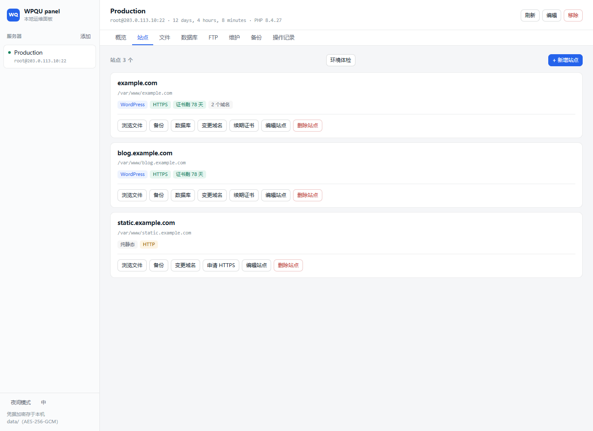
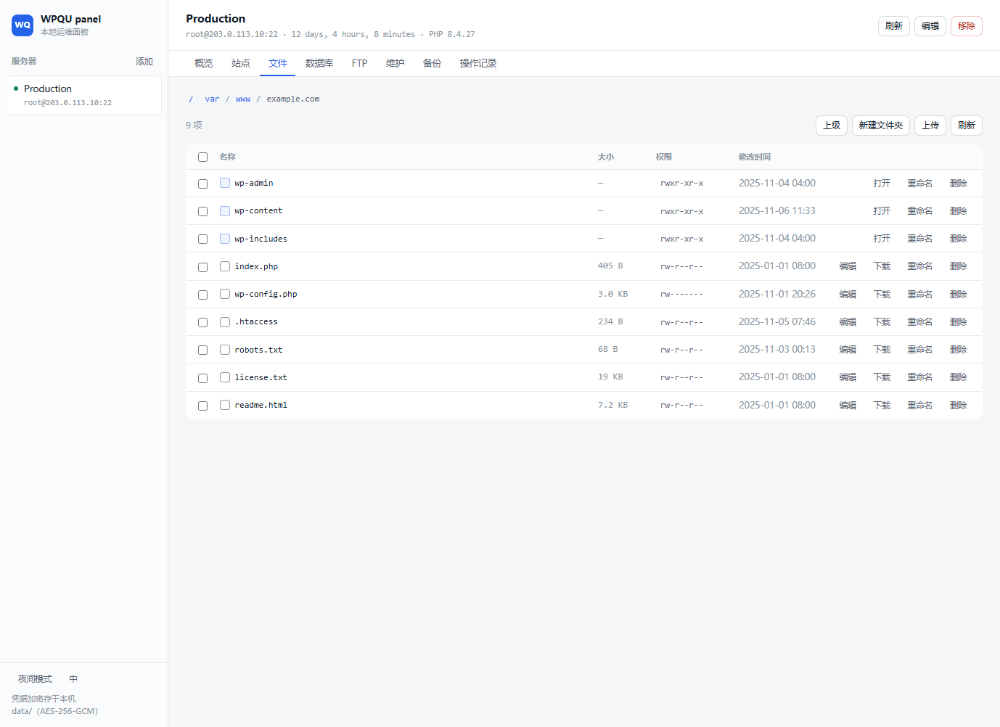

# 使用指南

[English](GUIDE.md) ｜ **简体中文**

这份文档按使用顺序写：怎么装、怎么连服务器、每个页签怎么用、卡住了查哪一节。
原理与实现见 [ARCHITECTURE.zh-CN.md](ARCHITECTURE.zh-CN.md)，接口见 [API.zh-CN.md](API.zh-CN.md)。

- [1. 开始之前](#1-开始之前)
- [2. 安装与启动](#2-安装与启动)
- [3. 添加第一台服务器](#3-添加第一台服务器)
- [4. 初始化空服务器](#4-初始化空服务器)
- [5. 站点](#5-站点)
- [6. 文件](#6-文件)
- [7. 数据库](#7-数据库)
- [8. FTP](#8-ftp)
- [9. 维护](#9-维护)
- [10. 备份](#10-备份)
- [11. 操作记录](#11-操作记录)
- [12. 设置密码](#12-设置密码)
- [13. 界面设置](#13-界面设置)
- [14. 插件](#14-插件)
- [15. 更新](#15-更新)
- [16. 排错](#16-排错)
- [17. 卸载](#17-卸载)

## 1. 开始之前

**你的电脑**（跑面板的那台）：Windows 10+、macOS 12+、或带桌面的 Linux。不需要任何运行时，发布包是
自包含的。

**服务器**：

| 项目 | 要求 |
|---|---|
| 系统 | Debian 12/13、Ubuntu 22.04/24.04（x86_64 / arm64） |
| 权限 | 能 `root` 登录，或该用户可 `sudo -n`（免密） |
| 网络 | 80 / 443 可达（HTTP/HTTPS 与 Let's Encrypt 都需要） |
| 解析 | 要给哪个域名签证书，就先把它 A 记录指到这台机器 |

面板假设这些站点由它独家管理。如果机器上已有你手工维护的 nginx/Apache 配置，先读
[第 5 节](#5-站点)：面板是按自己的规则管理 `sites-available` 的。

## 2. 安装与启动

### Windows

下载 `wpqu-panel-windows-amd64.exe`，放到一个固定目录（比如 `C:\Tools\wpqu-panel\`），双击。
起来后自动打开默认浏览器。

- 不弹命令行窗口。如果它起不来，用终端跑 `wpqu-panel-windows-amd64-console.exe`，那个会把原因打出来
- 再双击一次**不会**开第二个进程：它会找到正在运行的实例，比对版本，复用或者替换掉旧的
- `wpqu-panel.exe -stop` 停止（没有控制台，结果用弹窗提示）

### Linux / macOS

```bash
chmod +x wpqu-panel-linux-amd64
./wpqu-panel-linux-amd64
```

macOS 上如果被 Gatekeeper 拦住（未签名二进制）：右键 → 打开，或
`xattr -d com.apple.quarantine wpqu-panel-darwin-arm64`。

### 作为系统服务运行（可选）

只在你信任的机器上这么做——面板没有登录，服务绑 `0.0.0.0` 等于把服务器交给任何能访问端口的人。
下面这份 unit 只监听本机：

```ini
# /etc/systemd/system/wpqu-panel.service
[Unit]
Description=WPQU panel
After=network-online.target

[Service]
Type=simple
User=youruser
ExecStart=/opt/wpqu-panel/wpqu-panel -no-browser
Restart=on-failure
Environment=PANEL_DATA=/opt/wpqu-panel/data

[Install]
WantedBy=multi-user.target
```

```bash
sudo systemctl daemon-reload && sudo systemctl enable --now wpqu-panel
```

### 启动参数

| 参数 | 环境变量 | 默认 | 说明 |
|---|---|---|---|
| `-port` | `PORT` | `7788` | 监听端口。被占用时自动向后找 20 个 |
| `-host` | `HOST` | `127.0.0.1` | 监听地址，保持本机即可 |
| `-data` | `PANEL_DATA` | 见下 | 数据目录 |
| `-no-browser` | — | 关 | 启动后不打开浏览器 |
| `-stop` | — | — | 停掉 `-port` 上正在跑的实例 |

### 数据目录

服务器档案不在工作目录里，这样二进制挪位置不会丢服务器：

| 系统 | 路径 |
|---|---|
| Windows | `%APPDATA%\wpqu-panel\data` |
| macOS / Linux | `~/.config/wpqu-panel/data` |

```
data/
├── servers.json      服务器清单；密码与私钥是 AES-256-GCM 密文
├── secret.key        32 字节密钥（base64）。丢了已存凭据就解不开
├── panel.log         启动日志，GUI 版双击没反应时先看这里
├── logs/             每天一个 .ndjson，记录所有操作
└── backups/          站点备份，每台服务器一个子目录
```

首次启动时若发现二进制旁边（或改名前的 `wp-panel` 目录里）有 `servers.json`，会复制一份到默认位置；
源目录不删。

想开两个互不干扰的实例（比如工作与个人各一套档案）：

```bash
PANEL_DATA=~/.config/wpqu-panel-work/data ./wpqu-panel -port 7790
```

## 3. 添加第一台服务器

侧栏 → **添加**：

| 字段 | 说明 |
|---|---|
| 名称 | 随便起，给自己看（`生产`、`法兰克福-1`） |
| 主机 | IPv4、IPv6 或域名 |
| 端口 | SSH 端口，默认 22 |
| 用户 | `root`，或有免密 `sudo` 的用户 |
| 认证 | 密码，或私钥（OpenSSH 格式，可带 passphrase） |

先点 **测试**：连一次 SSH 跑条简单命令。再点 **环境体检**，它会逐项打勾：

| 检查项 | 什么时候判定失败 |
|---|---|
| SSH | 连接被拒、认证失败、主机不可达 |
| 系统 | 不是 Debian/Ubuntu |
| Web 服务器 | nginx 和 Apache 都没装或都没在跑 |
| PHP-FPM | 没有 `php*-fpm` 服务 |
| 数据库 | MariaDB / MySQL 都没装，或 `root` 不能免密连接 |
| WP-CLI | 缺失或损坏（建站、换域名都依赖它） |
| 磁盘 | 剩余空间过小 |
| Certbot | 缺失，签不了证书 |
| 时间 | 时钟偏差大到会影响 TLS |

体检是只读的。第一次写操作之前先跑一次，能提前发现大部分问题。

## 4. 初始化空服务器

**站点 → 初始化环境**，依次选：Web 服务器、PHP 版本、数据库引擎，然后配第一个站点。

| 选择 | 可选项 | 说明 |
|---|---|---|
| Web 服务器 | nginx（默认）、Apache 2.4 | Apache 用 `mpm_event` + `proxy_fcgi`，WordPress 伪静态走 `.htaccess` |
| PHP | 发行版默认、8.0–8.4 | 缺的版本会自动加 Sury/ondrej 源 |
| 数据库 | MariaDB（默认）、MySQL 8.4 LTS、MySQL 5.7 | MySQL 5.7 仅 Debian，且需要 Oracle 的历史包 |
| 首个站点 | 域名、标题、管理员账号密码邮箱、是否 HTTPS | 用 WP-CLI 下载并安装 WordPress |

安装脚本是幂等的：在已配好的机器上重跑只做检查，不会重装；改 `php.ini` 与 pool 之前都会先备份。

过程在抽屉里实时输出。某一步失败就停在那里并给出具体那行，同时记进操作记录——不会静默跳过。

## 5. 站点

**站点** 页列出的东西是**读回来的**：读 Web 服务器自己的配置，而不是面板的数据库。

| 列 | 来源 |
|---|---|
| 域名 | `server_name`（nginx）/ `ServerName` + `ServerAlias`（Apache） |
| 类型 | `/etc/wp-panel/site-types/<域名>` 里的标记 |
| PHP | 配置里是否有指向 FPM socket 的 `fastcgi_pass` / `proxy:unix:` |
| HTTPS | vhost 是否监听 443 或有证书 |
| 根目录 | `root` / `DocumentRoot` |

纯跳转的 vhost（没有根目录）单独列出，可以删但不能编辑——它的存在意义就是把旧域名 301 到新域名。



### 新建站点

**新增站点** 要域名 + 类型：

| 类型 | 会创建什么 |
|---|---|
| **WordPress** | 目录、数据库与账号、`wp-config.php`、WP-CLI 安装、伪静态规则、vhost、可选证书 |
| **自助 PHP** | 目录与占位 `index.php`、PHP-FPM pool、vhost——给你自己上传程序用 |
| **纯静态** | 目录与占位 `index.html`、关掉 PHP 的 vhost（`.php` 返回 403） |

可选：独立 PHP-FPM pool（默认同一 PHP 版本共用一个 pool）、PHP 版本、HTTPS（certbot webroot）、
WordPress 的管理员账号与语言。

### 转换类型

**类型 → 转换** 只重写 vhost 里的能力部分；**转到** WordPress 会装一份全新的，不会把已有文件改造成
WordPress 站。**从** WordPress 切走时文件和数据库原样保留，WordPress 的伪静态规则会被挪到一边
（Apache 上 `.htaccess` → `.htaccess.wp-bak-<时间戳>`），切回来不丢东西。

改之前的配置会先归档到 `/root/`；Web 服务器配置校验不过就自动还原。

### 换域名

**换域名** 只对 WordPress 站点开放（因为要改数据库里的 `siteurl` / `home`）：

1. `/var/www/<旧>` 改名为 `/var/www/<新>`
2. 重写 vhost、证书路径、PHP-FPM 的 `chdir`
3. 给旧域名写一个只做跳转的 vhost（301 到新域名）
4. 更新数据库里的 `siteurl`/`home`，用 WP-CLI 校验
5. 重载 Web 服务器与 PHP-FPM

旧 vhost 是故意留着的：收藏夹和搜索引擎会落到 301 上。等你不需要跳转了，再到站点列表里把它删掉。

### 删除站点

**删除** 要求手工输入完整域名。删除范围可选：

- Web 服务器配置（`sites-available` + `sites-enabled`，以及 nginx 的能力片段）
- 站点目录（只接受 `/var/www/<域名>`）
- 数据库及其账号
- Let's Encrypt 证书

删之前配置会备份到 `/tmp/wp-delsite.*/backup`。仍被其它站点引用的 PHP-FPM pool 会保留；只给这个站点
用的 pool 会一并删掉。

## 6. 文件

以站点目录为起点的 SFTP 双栏浏览器（也可以往 SSH 用户能读的任何路径走）。



| 操作 | 说明 |
|---|---|
| 编辑 | 浏览器内编辑器，UTF-8，保存即原地写入 |
| 上传 / 下载 | 走 SFTP 流式传输，除磁盘外没有大小限制 |
| 重命名、删除、新建目录 | 单个或批量（工具栏勾选框 → 全选） |
| 权限 | 显示 `rwxr-xr-x`，可填八进制（`644`、`755`、`4755`），目录支持递归 |
| 批量 | 对选中项改权限 / 删除 / 复制 / 移动 |

改权限只动 mode 位，不动属主。几 MB 以上的文件不在编辑器里打开，用下载。

## 7. 数据库

选服务器 → 选库 → 选表。可以翻页看数据、看表结构、在控制台里执行 SQL。

写语句是允许的，但会被检查：管账号、碰服务器文件的语句一律拒绝（`CREATE USER`、`GRANT`、
`SET PASSWORD`、`LOAD DATA`、`INTO OUTFILE`、`LOAD_FILE`、`INSTALL PLUGIN`）。账号与权限管理请手工做，
那是需要慎重的事。

导出会生成 gzip 压缩的 dump 直接下到浏览器（整台或单库）。导入接受 `.sql` 与 `.sql.gz`，用对应的客户端
执行。`OPTIMIZE TABLE` 可以按表或按库跑。

## 8. FTP

默认关闭，你不点它就不装任何东西。

1. **安装 vsftpd**：面板写一份本地用户 + chroot + 被动端口段的配置，不启用 TLS（内网用；跨公网请用 SFTP）
2. 客户端从外网连的话，把**被动地址**设成服务器公网 IP
3. **加账号**：用户名、密码、目录（限制在 `/var/www/<域名>`）、模式（只读 / 读写）

账号复用站点目录属主的 UID/GID，所以上传的文件 PHP 和 Web 服务器立刻能写——不会出现「传上去了但
WordPress 后台改不了」。

## 9. 维护

### 紧急修复

基础软件（nginx、PHP 等）爆出重大漏洞时，面板不用升级：这个子标签会去
`https://panel.wpqu.com/api/security.json` 拉一份**带签名**的清单，里面是公告和检测/修复规则。

- 打开即检测：命中的项会写明「现版本 → 修复版」，并给出一键修复按钮
- 「查看命令」先看脚本，「一键修复」才执行；输出实时回显，跑完自动复检一次
- 命令随清单签名（与升级包同一把发布公钥），验签不过不会执行；接口只收修复编号，前端拼不出命令
- 清单里的 `minPanel` 高于当前版本时该项跳过，老面板不会跑不认识的格式

### PHP 版本

列出所有已装的 `php*-fpm`、默认 CLI 版本、以及每个站点绑定的版本（从 vhost 里实际的 socket 读出来，
不是猜的）。

- **安装**某个版本（需要时自动加 Sury/ondrej 源）
- **卸载**没有站点在用的版本
- **切换站点**版本：复制 pool 文件、改 socket 路径、重载两个服务；失败自动回滚。重载期间会有不到 1 秒的 502
- **设默认 CLI** 版本（`update-alternatives`）

### 网站日志

列出站点访问/错误日志、php-fpm 日志、WordPress `debug.log`，以及轮转出来的归档。

| 按钮 | 效果 |
|---|---|
| 查看 | `tail -n 100/200/500/1000`，`.gz` 先解压 |
| 下载 | 走 SFTP |
| 轮转 | 压缩成 `xxx.log.<时间戳>.gz`，原文件截断，重新打开日志 |
| 清空 | 原地截断（`: > 文件`）——inode 不变，空间立刻回收，服务不用重启 |
| 删除 | 只对归档开放 |

路径在两处白名单（路由与脚本）双重校验：只允许 nginx/Apache 日志、`php-fpm-*.log`、
`/var/www/*/wp-content/debug.log`。

### 定时任务

列出 root 的 crontab，包括不是面板建的条目。

- 面板建的条目带 `# wpqu:<id> <备注>` 标记，停用是加 `# wpqu-off ` 前缀，不删原行
- **立即执行**会马上跑一次，输出实时回显
- 手写条目只展示、不改写——面板只重写它自己创建的那些行

### 执行命令

以 root 执行任意 shell，输出实时流式回显。危险模式（`rm -rf /`、`mkfs`、`dd of=/dev/…`、`shutdown`、
fork 炸弹）需要二次确认。界面没覆盖的事情都从这里做。

## 10. 备份

站点卡片上的 **备份** 会把站点目录打成 tar.gz，可选带一份数据库 dump，存到 `data/backups/<服务器>/`。
备份放在你自己电脑上，不是服务器上——这符合备份的本意，但意味着笔记本丢了备份也没了，重要的话请另存一份。

目前没有「还原」按钮：下载归档，用 SSH 上去 `tar -xzf` 解开。里面的数据库 dump 是普通 `.sql`，
喂给 `mysql`/`mariadb` 即可。

## 11. 操作记录

每个写操作都会追加到 `data/logs/<日期>.ndjson`，同时显示在 **操作记录** 页：时间、服务器、动作、对象、
结果、耗时、错误。只读操作不记录，这样文件里剩的都是有意义的。

失败的记录会带上从服务器收集到的诊断尾巴，通常足以看出是配置校验、包冲突还是证书挑战的问题。

## 12. 设置密码

选中某台服务器后，右上角有 **设置密码** 按钮。这是一个可选的本地加密功能：给这台服务器的凭据
（SSH 密码 / 私钥）再上一把锁。加密只发生在本机 —— 凭据先用面板自己的机器密钥加密存储，
设置密码后会再用你口令派生的密钥（scrypt → AES-256-GCM）重加密一遍，原 `secret` 字段随之删除。

要点：

- **只限长度，不限复杂度** —— 至少 6 位，数字、字母、符号都行；三位数字这种等于没设
- **密码不落盘** —— 面板只存 salt 和一个验证器（同一把派生密钥加密的固定串），口令本身不存在任何文件里
- **连错 5 次锁 1 小时** —— 错误计数和锁定截止时间都落盘，重启面板也不会清零；锁定期间连正确密码也会被拒
- **解锁有会话** —— 输对一次后 30 分钟内免密，期间操作会自动续期；顶栏随时可以 **立即锁定**，只清内存密钥、不动你设的口令
- **改凭据要先解锁** —— 已加密的服务器改密码 / 私钥同样要求先解锁，改完仍用口令密钥保存
- **忘了密码可以重置** —— 口令本身不会存在任何地方，忘掉就无法解开；「设置密码」里有 **忘记密码 / 重置**，会连同面板保存的凭据一起清掉，重新填一次即可（服务器上的站点和数据不受影响）

未解锁时，任何会用到这台服务器凭据的操作都会返回 423，面板弹一次解锁框，输对后自动重放刚才的操作。

不想用这个功能就不设，一切照旧。想关掉就点 **设置密码 → 关闭加密**（要输当前口令验证），凭据会改回机器密钥加密。

## 13. 界面设置

- **主题**：侧栏底部一对并列按钮（☀ 浅色 / ☾ 深色），点哪个用哪个，当前生效的高亮；按浏览器记住，没手动切过就跟随系统
- **语言**：`CH` / `EN` 两个并列按钮切换，按浏览器记住；`?lang=en` / `?lang=zh-CN` 可让一条链接强制指定语言
- 侧栏最下方是 `panel.wpqu.com` 的官网入口，新窗口打开
- 服务器名、域名、数据库名、日志正文、命令输出永远不翻译

## 14. 插件

插件解决「面板没做、但你确实要装」的事：给服务器装一套 Go、Python、Node 运行时，装 Docker，装
OpenClaw（小龙虾），或者给面板自己加一个页签。

**面板本体永远不会自己往服务器上装东西**——不点安装，服务器上什么都不会变。

### 插件从哪来

侧栏 **插件** 页。清单由 `panel.wpqu.com/api/plugins/index.json` 分发，带签名；面板拉到后先用编在
二进制里的公钥验签，**过不了就整个不显示**——宁可空着，也不能让中间人塞一个「安装脚本」进来。
清单在内存里缓存 5 分钟，点 **刷新市场** 会强制重拉。

首批有 6 个：

| 插件 | 分类 | 价格 | 装了什么 |
|---|---|---|---|
| Go | 运行时 | 免费 | `/usr/local/go` + `/etc/profile.d/go.sh` |
| Python | 运行时 | 免费 | `python3-pip`/`venv`/`dev` + uv 到 `/usr/local/bin` |
| Node.js | 运行时 | 免费 | NodeSource 源，默认装 22 |
| Docker | 运维 | 免费 | 官方 `get.docker.com` |
| OpenClaw | AI | ¥199 | Node 24+，官方安装脚本，配好监听端口 |
| 备忘 | 面板 | 免费 | 不碰服务器，只给面板加一个页签 |

### 安装

1. 左侧先选中目标服务器。没选的时候按钮是灰的 **先选择服务器**（面板类插件除外）
2. 点卡片 **详情**，看清它装什么、要什么参数；有参数的在这里填，比如 Node 的 `major`（默认 22）、
   OpenClaw 的端口（默认 18789）、Go 的版本（留空取当前稳定版）
3. 点 **安装到服务器**，右边滑出抽屉，每步一行 `▸ [1/3] 安装 Go`，脚本的原始输出跟在后面

装完不用登服务器重启什么：`/etc/profile.d` 的改动下次登录生效，`systemctl` 的改动当场生效。

**这一步是以 root 跑的。** 插件脚本来自签名过的包，但本质上仍然是「在你机器上执行 shell」。
详情里列了它会做什么，装之前看一眼；不放心就先在快照或测试机上装一遍。

### 收费插件与授权码

收费插件卡片上是 `¥199`，详情里有「需要授权码」，按钮是灰的。授权码长这样：

```
WPQU1.eyJwIjoib3BlbmNsYXciLCJlIjoiMjAyNy0xMi0zMSIsInMiOjUsIm4iOiLlvKDkuIkiLCJpIjoi...
```

**激活步骤**：买码 → 插件详情 → 粘贴进授权码框 → 保存。码在本机验签（Ed25519，公钥编在面板里），
不联网、不注册账号、不心跳。验过之后按钮变可点。

几个实际会遇到的点：

- 码是**按产品**绑的，`openclaw` 的码贴到 `golang` 上会被拒绝，并告诉你它属于谁
- 码有到期日，**过期后已装好的插件照常跑，但重装/升级会被拒**
- 一个码可以删掉重贴，比如换机器
- 授权码存在 `data/licenses.json`，跟数据目录一起走

### 状态检测

打开插件页时，面板会拿所有已装插件的检测命令拼成**一次** SSH 执行（`###<id>` 分隔），
一次往返就知道哪个装了、版本多少。不再是一个插件一条连接。

已安装的插件卡片会显示版本号，按钮变成 **卸载** 和 **重新安装**。

### 卸载

卸载只回滚插件自己装的那部分，数据一律保留：

| 插件 | 卸载会删 | 卸载不会删 |
|---|---|---|
| Go | `/usr/local/go`、`/etc/profile.d/go.sh` | `go install` 装到 `~/go/bin` 的命令 |
| Python | `/usr/local/bin/uv`、`uvx` | 系统 `python3` 与已装的 apt 包 |
| Node.js | `nodejs` 包、NodeSource 源 | `/usr/lib/node_modules` 里的全局包 |
| Docker | 五个官方包 | `/var/lib/docker`（镜像、容器、数据卷） |
| OpenClaw | `openclaw` 命令、systemd drop-in | `~/.openclaw`（会话、记忆、渠道凭据） |

想连数据一起清，按脚本最后一行打印的路径手工删。面板不会替你删这些，因为删错了不可恢复。

### 面板类插件

有的插件不装服务器，只给面板加一个页签（比如「备忘」）。这类插件卡片上的按钮是 **安装到面板**，
装的是面板侧的一小段 JS，只在你本机跑，卸载对应 **从面板移除**。

### 拉不到清单时

面板不存清单的离线副本，只有 5 分钟的内存缓存。拉不到 `panel.wpqu.com` 就在页顶挂一条黄色提示，
已装好的插件照常能卸载，点 **刷新市场** 重试。这是有意为之：拿一份过期的清单去装软件，
比装不上更糟。

内网环境可以把面板指向自己的镜像（见 [15. 更新](#15-更新) 的 `WPQU_UPDATE_BASE`），
清单和包都从镜像拉，签名照验。

已经装过的插件包留在 `data/plugins/<id>/`，同一版本点 **重新安装** 不会重新下载。

## 15. 更新

侧栏底部那个 `v1.10.1` 按钮就是入口。点开是「关于」，里面有版本号、更新检查、以及更新内容。

### 什么时候检查

**只在你点的时候查。** 面板不后台轮询、不埋遥测、启动时不打电话回家。想查就点一下。

检查会拉 `panel.wpqu.com/api/updates.json`（带签名），比对版本号，挑出你这台机器的
`GOOS/GOARCH` 对应的包。结果三种：

- 已是最新：只显示当前版本
- 有新版本：显示版本号、包大小、更新说明，带 `重要更新` 标记的会在标题旁单独标出来
- 查不到：显示原因（断网、源不可达、签名不通过），不弹错误框

### 升级过程

点 **立即升级** 之后分三段，任何一段失败都**不动你现在的二进制**：

| 阶段 | 做什么 | 失败会怎样 |
|---|---|---|
| 检查 | 重新拉清单、验签、选包 | 停在原地，报原因 |
| 下载 | 边下边算 SHA256，写 `data/tmp/` | 删临时文件，旧版本继续跑 |
| 替换 | 换文件、重启进程 | 回滚，旧版本继续跑 |

替换那一步在 Windows 和 Linux 上做法不同，但对你是一样的：**面板会自己重启，浏览器里等它回来**。
升级过程中页面会显示进度，重启后自动刷新到新版本。

Windows 上运行中的 exe 不能覆盖但能改名，所以流程是「旧 exe 改名 → 新 exe 就位 → 起新进程」，
`.old` 文件留到下次启动才删——万一新版本起不来，把它改回去就行。

### 它不动什么

- 不动服务器上的 nginx / PHP / MySQL，那是 **维护** 页的事
- 不动 `data/`：站点、数据库密码、备份、操作记录、插件、授权码全在
- 不覆盖你的 `-data` 参数和工作目录（重启时原样传回去）

### 内网 / 自建源

设环境变量 `WPQU_UPDATE_BASE` 指到你自己的镜像（目录结构跟 `site/` 一样），面板就只认那个源：

```bash
WPQU_UPDATE_BASE=https://mirror.internal/wpqu ./wpqu-panel-linux-amd64
```

签名还是要验。自建源要用自己的密钥重新签一份 `updates.json`，公钥编在二进制里（`internal/signing`），
所以要么重新编译，要么用官方的包。

## 16. 排错

### GUI 版双击没反应

用终端跑控制台版。常见原因：端口被别的程序占着（面板会自动顺延，所以少见）、数据目录不可写。
`data/panel.log` 里有同样的输出。

### 浏览器没自动打开

手动打开 `panel.log` 里打印的地址。Linux 无桌面环境时本来就没有默认浏览器，可能也没装 `xdg-open`。

### 测试服务器时「连接被拒」

端口不对、SSH 没跑、或云安全组没放行。服务器上 `ss -lntp | grep :22`，再看控制台防火墙。

### 面板显示没有站点，但 nginx 里明明有

面板读的是**正在运行**的 Web 服务器的配置目录。nginx 与 Apache 都装时，跟实际在跑的那个走，
用 `systemctl is-active nginx apache2` 看。没有根目录的纯跳转 vhost 按设计单独归类。

### 签证书失败

- 域名没解析到这台机器（`dig +short example.com`）
- 80 端口被云厂商或防火墙挡了
- 已有别的 vhost 占着这个域名
- 撞上 Let's Encrypt 的频率限制（每域名每小时 5 次失败）

certbot 的原始报错会原样流到抽屉里。

### 切 PHP 版本后 502

新版本的 pool 没起来。`systemctl status php8.x-fpm`，再看
`/etc/php/8.x/fpm/pool.d/<域名>.conf`。配置校验失败面板会回滚，但「能启动随后崩掉」属于运行时问题，
通常缺扩展。

### 哪都不对但服务器好好的

`tail -50 ~/.config/wpqu-panel/data/panel.log`（Windows 是 `%APPDATA%\wpqu-panel\data\panel.log`）。
启动、选端口、最终用的数据目录都记在这里。

### 插件装到一半失败

脚本是逐条执行的，某条挂了就停在那里，前面已经装好的部分**不会自动回滚**（回滚 apt 装了一半的东西
比不滚更危险）。抽屉里能看到停在第几步（`▸ [2/3] …`），末尾那行 `错误：…` 是原因。
修好之后点 **重新安装**，这些脚本都是可重入的，重复跑一遍不会装出两份。

常见的三条：

- `apt-get` 拿不到锁：服务器上有 `unattended-upgrades` 在跑，等两分钟
- 下载超时：服务器出不去外网，或者 DNS 有问题，`curl -I https://go.dev` 试一下
- `openclaw` 端口被占：`ss -lntp | grep 18789`，改参数重装

### 更新后打不开

先看 `data/update.log`，它有完整的检查/下载/替换过程。Windows 上如果 `wpqu-panel.exe` 换成新的之后
起不来，同目录下还有一个 `wpqu-panel.exe.old`，改名回去就退回旧版本（数据没动过，直接能用）。

Linux 上替换是原子的，起不来通常是权限或架构不对（`file wpqu-panel-linux-amd64` 看架构），
用控制台版跑一次能看到原因。

## 17. 卸载

面板就是一个二进制加一个数据目录：

```bash
./wpqu-panel -stop
rm -rf ~/.config/wpqu-panel        # Windows 用 %APPDATA%\wpqu-panel
```

服务器上的站点、数据库、证书一律不动。要连站点一起清掉，先用 **站点 → 删除**，或者按
[README](../README.zh-CN.md#服务器上装了什么) 里的路径手工清理。
